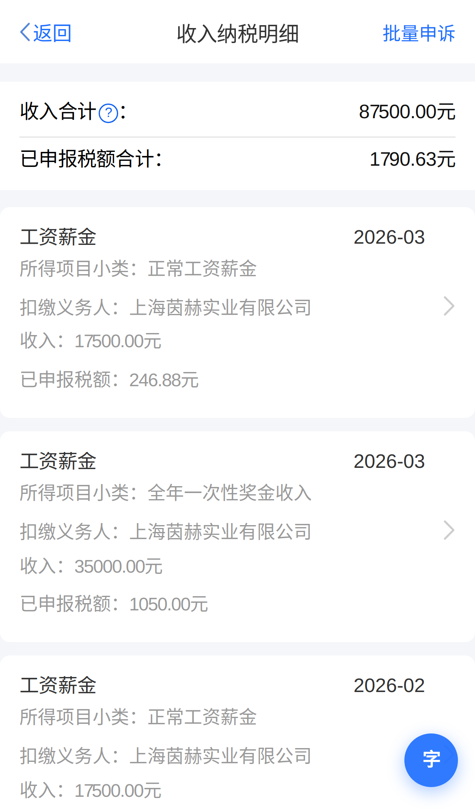
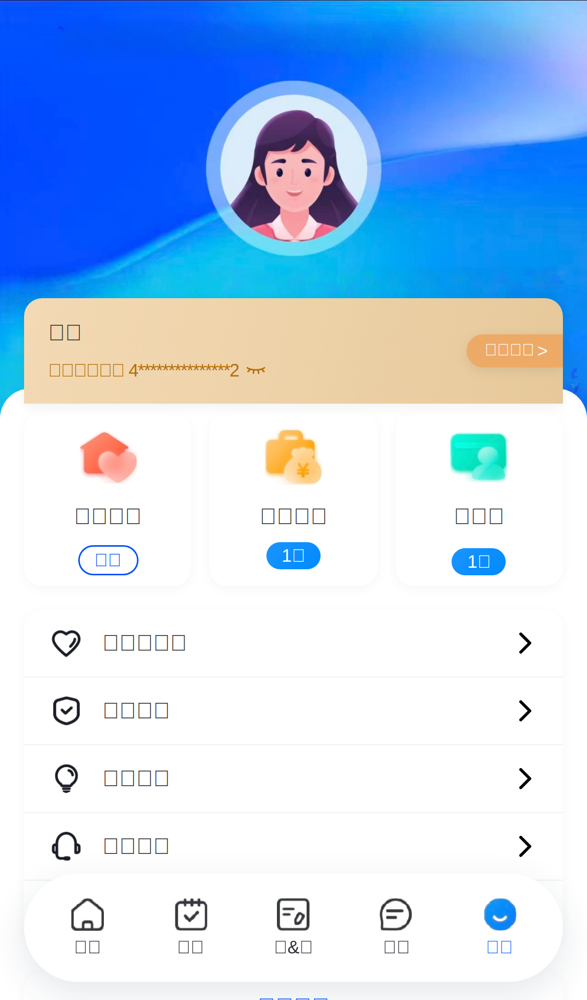

# 个税模拟器

QQ：**498771018**

个人所得税相关界面与流程的**演示软件**，用于学习演示、界面参考、技术交流、截图录屏。与任何政府机关 / 官方 APP **无关联**。

**安装页：** [https://geshui.中国/install_guide.html](https://geshui.中国/install_guide.html)（可下载安装包，也可**直接注册账号**）

---

## 核心功能（先看这些）

打开 App 后，最常用的是下面几件事：**维护演示税务数据 → 在收入纳税明细里查看 → 按需改姓名 / 税号 / 任职等信息**。对应页面如下。

| 核心能力 | 你在 App 里做什么 | 对应页面 |
|----------|-------------------|----------|
| **收入纳税明细** | 看年度收入合计、已申报税额，以及按月工资薪金列表 / 详情（截图录屏主场景） | 首页卡片或 **办&查 → 收入纳税明细** |
| **纳税记录开具** | 按年度生成演示版纳税记录、查询验证码与记录详情（完税类截图场景） | 首页卡片、**办&查 → 纳税记录开具** |
| **税务记录维护** | **一键生成 / 批量添加**工作经历与月薪、社保、专项附加；支持编辑、删除、回收站 | **我的 → 我要咨询**（个人中心 · 税务记录） |
| **专项附加扣除** | 填报子女教育、住房贷款等专项附加扣除演示流程 | **办&查**、首页专题区、**搜索** |
| **首页 / 办&查** | 年度汇算、专项附加、个人养老金、经营所得、申报记录、异议申诉等入口 | 底部 Tab：**首页**、**办&查** |
| **搜索** | 按名称快速找到功能与服务 | 首页顶部 **搜索** |
| **更多功能** | 自定义首页重点服务顺序（最多 7 项） | 首页 **更多功能** → 重点服务管理 |
| **我的** | 改姓名 / 税号、家庭成员、任职受雇、银行卡、**激活码开通** | 底部 Tab：**我的** |
| **激活与去水印** | 未激活账号界面带演示水印；激活后完整体验明细、记录等 | **我的 → 激活** |
| **多端安装** | Android 安装包、iOS 描述文件、模拟器可用；页内安装教程视频 | 安装页 / **我的 → 关于&更新** |

### 按需开通的扩展演示（卖家提供入口链接）

以下为**独立演示模块**，非税务机关正式文书；是否可用以卖家说明为准。

| 模块 | 说明 |
|------|------|
| **在职 / 离职证明** | 生成演示版在职、离职证明样张，支持预览与保存 |
| **社保权益单演示** | 多省市参保证明 / 缴费明细 PDF 演示样张 |
| **公积金等** | 部分渠道提供的公积金核验类演示页 |

---

## 核心功能页面展示

### 1. 收入纳税明细

- 顶部：**收入合计**、**已申报税额合计**
- 列表：按月「工资薪金」（所得小类、扣缴义务人、收入、税额）
- 支持进入详情、批量申诉（演示流程）

### 2. 税务记录维护（一键生成 / 批量添加）

- **一键生成 / 展开添加**：按累计预扣逻辑批量写入演示数据
- 支持示例填写、列表核对、单条编辑 / 删除、按单位一键删除
- 保存后即可在「收入纳税明细」中查看

### 3. 首页

搜索栏、年度汇算专题、专项附加扣除推荐，以及「收入纳税明细」「纳税记录开具」等入口；底部五栏：**首页 / 待办 / 办&查 / 消息 / 我的**。

### 4. 办&查

- **办税**：综合所得年度汇算、专项附加扣除、个人养老金、经营所得、纳税记录开具、公益慈善等  
- **查询**：收入纳税明细、申报记录、异议申诉

### 5. 我的

头像与纳税人识别号、个人信息入口；快捷区含**家庭成员 / 任职受雇 / 银行卡**；菜单含关怀版、安全中心、帮助中心、**我要咨询**、关于&更新；支持激活码开通。

### 6. 纳税记录开具

- 选择纳税年度，生成演示版**纳税记录**与**查询验证码**
- 支持记录列表、详情页截图；未激活账号可能显示演示水印，激活后去除
- 入口：**首页**重点服务、**办&查**办税区，或 **搜索「纳税记录」**

---

## 下载安装

请使用**卖家 / 客服提供的最新安装页**打开；页内可下载 **Android 安装包** 与 **iOS 描述文件**，并观看安装教程视频。同一安装页也可 **注册账号**，不必先装 App 再注册。

| 端 | 安装方式 |
|----|----------|
| **安卓 / Android** | 打开 [安装页](https://geshui.中国/install_guide.html)，点击 **「下载 Android 安装包」**；若提示「未知来源」，请在设置中允许本次安装。 |
| **苹果 iOS** | 打开 [安装页](https://geshui.中国/install_guide.html)，点击 **「下载 iOS 描述文件」**，按页内 **苹果安装视频** 操作；安装后到 **设置 → 通用 → VPN 与设备管理** 中信任描述文件。 |
| **PC** | 先安装 [雷电模拟器](https://www.ldmnq.com/)（或其它 Android 模拟器），在模拟器内安装上述 Android 包即可。 |
| **仅注册** | 打开 [安装页](https://geshui.中国/install_guide.html)，点击 **「注册账号」**，按提示完成注册；再在 App 或浏览器登录使用。 |

**已安装旧版：** App → **我的** → **关于&更新** → **安装包和使用方法**，可再次下载或看教程。

---

## 使用方式（最短路径）

1. **安装或注册** → 下载 App，或在 [安装页](https://geshui.中国/install_guide.html) **注册账号**后登录  
2. **激活** → 在 **我的 → 激活** 输入激活码（去水印并开通完整演示功能）  
3. **我的 → 我要咨询 / 税务记录**：一键生成或批量添加演示数据并保存  
4. **办&查 → 收入纳税明细**：查看汇总与月度明细（截图 / 录屏）  
5. **首页 / 办&查 → 纳税记录开具**：按需生成年度纳税记录演示  
6. 需要时在 **我的** 修改姓名、税号、任职、家庭成员等；用 **搜索** 快速找其它办税查询入口

---

## 演示视频

- **苹果安装视频**：iPhone / iPad 描述文件安装与信任  
- **操作视频**：App 基本用法  

均在 **「安装包和使用方法」** 页播放；安装后也可从 **我的 → 关于&更新** 进入观看。

---

## 常见问题

**打不开安装页？**  
确认网络正常，并使用卖家最新提供的完整链接（当前默认：[geshui.中国 安装页](https://geshui.中国/install_guide.html)）。

**安卓提示无法安装？**  
允许「安装未知应用」；仍失败可删除旧版后重装。

**iOS 安装后找不到图标？**  
按安装页苹果视频完成描述文件信任。

**提示未激活或界面有水印？**  
在 **「我的」→「激活」** 输入有效激活码；激活码由购买渠道提供，本仓库不提供官方税务服务。

**明细里没有数据？**  
先到 **税务记录** 一键生成或批量添加并保存，再进入收入纳税明细刷新查看。

**纳税记录开具没有条目？**  
先维护税务记录并保存，再在「纳税记录开具」中选择对应年度生成。

---

## 免责声明

本软件仅供演示与交流，**与任何政府机关、官方 APP 无关联**。所有证明、记录、权益单等均为**演示样例**，不具有官方效力。使用者须自行遵守法律法规，并对使用行为负责。本仓库不出售激活码、不提供真实报税服务。
